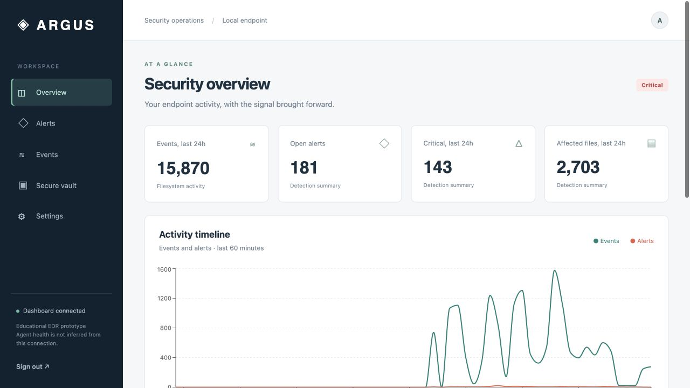
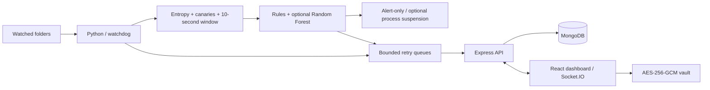

# Argus

An intelligent machine learning-powered security monitoring and threat detection system.

Argus implements the Mini-EDR specification as a local, educational endpoint-monitoring application: a Python agent, authenticated Express/MongoDB API, React dashboard, and password-encrypted file vault. It detects suspicious file changes using entropy, extension changes, canary files, sliding-window rules, and an optional Random Forest trained on synthetic events.

**Status:** all application components are implemented. See [evaluation](docs/evaluation.md) for measured results, unmet targets, and platform coverage. Detection is heuristic; this is not a commercial EDR or antivirus replacement.

## Dashboard preview



The screenshot contains disposable test activity, not real threat detections.

## Architecture



## Requirements

- Python **3.12+ for the pinned dependency set**; Python 3.14 was used for local validation. The source targets 3.10+ syntax, but newer pinned dependencies may require a newer interpreter.
- Node.js 24 LTS (tested with 24.22.0), npm, and MongoDB Community Server.
- Windows or Linux are the specified target platforms. Local validation was performed on macOS arm64; Windows/Linux CI is included but its result must be checked on GitHub.
- No paid services, administrator permissions for detection, or malware samples.

## Setup

Clone the repository and run all Python commands from its root:

```sh
git clone https://github.com/anshikarajpurohit/Argus.git
cd Argus
python3 -m venv .venv
source .venv/bin/activate
python -m pip install -r agent/requirements.txt
```

On Windows PowerShell use `py -m venv .venv` and `.venv\Scripts\Activate.ps1` instead.

Install JavaScript dependencies:

```sh
cd backend
npm ci
cd ../dashboard
npm ci
cd ..
```

Copy `backend/.env.example` to `backend/.env`. Set `MONGO_URI`, `ADMIN_USER`, a strong `ADMIN_PASS` (12+ characters), and distinct random values for `JWT_SECRET` and `AGENT_API_KEY`. Generate each secret separately with:

```sh
node -e "console.log(require('node:crypto').randomBytes(32).toString('hex'))"
```

Start your local MongoDB service. For a standalone development instance, create a database directory and run `mongod --dbpath <directory> --bind_ip 127.0.0.1`; this uses port 27017. MongoDB installation guidance: [official manual](https://www.mongodb.com/docs/manual/installation/).

Seed the administrator, then start the API in one terminal:

```sh
cd backend
npm run seed:admin
npm start
```

The API listens on `127.0.0.1:5000`. There is no public registration endpoint. Re-running the seed command updates that administrator's password.

Start the dashboard in a second terminal:

```sh
cd dashboard
npm run dev
```

Open **http://localhost:5173** and sign in with the credentials you set. Vite proxies `/api` and Socket.IO to the API; there is no separate browser API-key configuration.

Start the agent from a third terminal at the repository root:

```sh
source .venv/bin/activate
python dataset/make_fixtures.py --seed 42
export AGENT_API_KEY='<same value as backend/.env>'
python agent/main.py
```

In PowerShell use `$env:AGENT_API_KEY='<value>'`. Alternatively set `agent_api_key` in a separate local configuration file and pass `--config <path>`; do not commit that file. The environment variable overrides the YAML key. Never commit secrets to `agent/config.yaml`.

Watch paths are resolved relative to the repository root. Model paths are relative to `agent/`. The default watch path is the disposable `testbed/` folder. Change `watch_paths` only to folders you intend to monitor. Three canary files are created in each watched root. The vault directory, agent state directory, and selected configuration file are excluded even when an ancestor is watched. Logging goes to standard error, not to watched log files.

**macOS note:** the agent uses watchdog’s polling observer at 0.5-second intervals to avoid delayed FSEvents startup notifications. Windows/Linux use native observers. Port 5000 may be used by AirPlay, and `localhost` may resolve to its IPv6 listener. Set `backend_url: "http://127.0.0.1:5000"` in your local agent configuration if health checks or agent requests reach the wrong service. If changing the backend port, change the Vite proxy target and agent backend URL together.

## Safe demonstrations

The emulator only copies pre-generated bytes over disposable manifest fixtures, renames those fixtures, or appends harmless text. It cannot encrypt files and refuses paths outside this repository's `testbed/`.

```sh
python dataset/attack_emulator.py --mode fast --i-understand-this-is-a-sandbox
python dataset/attack_emulator.py --mode canary --i-understand-this-is-a-sandbox
```

Regenerate fixtures before the next demonstration. Prefer a fresh `--target testbed/demo-N` for clean measurements; reusing a directory can leave renamed files from an earlier run. Do not put personal data in `testbed/`.

Default response mode is **alert_only**. The Settings page can enable suspension, but user-space open handles only suggest which process was involved. Process suspension is unit-tested with mocks; the evaluation does not suspend real programs.

## Synthetic model

```sh
python dataset/make_fixtures.py --seed 42
python dataset/generate_events.py --seed 42
python dataset/train_model.py --seed 42
python dataset/replay_evaluation.py
```

These commands create 390 five-minute streams, split training/test data by scenario run, train the specified Random Forest, and write reports under `dataset/out/`. The model is written to `agent/models/rf_model.joblib`; restart the agent to load it. The agent works without a model. Only load locally trained/trusted joblib files because their deserialization can execute code.

Generated models, datasets, vault files, configuration secrets, and state are deliberately not committed. Reproducible training code and the measured reports are included. Synthetic performance does **not** establish real-world detection accuracy.

## Tests and evaluation

```sh
python -m pytest -q
cd backend
npm test
npm run lint
cd ../dashboard
npm test
npm run lint
npm run build
```

Backend integration tests require a running MongoDB instance. They default to port **27028** to keep tests separate from development. Set `MONGO_TEST_URI=mongodb://127.0.0.1:27017/` to use an existing local server; every test run uses and drops its own randomly named `argus_test_*` database.

For live timing, idle CPU, and benign-workload measurements see [the end-to-end procedure](dataset/run_e2e.md). The reproducible harness is `dataset/benchmark_live.py`; it requires a running backend, `AGENT_API_KEY`, `ADMIN_USER`, and `ADMIN_PASS` in its environment, and refuses to run when suspension is enabled.

## Dashboard and vault

- **Overview:** current status, event/alert counts, a 60-minute chart, and a live alert feed.
- **Alerts:** severity/status filters, affected-file details, probability, suspect process, and lifecycle updates.
- **Events:** action, canary, and time filters; newest 100 matching records (API supports up to 500).
- **Secure vault:** upload, decrypt/download, and confirmed deletion. Maximum 50 MB per file.
- **Settings:** response mode, warning/critical thresholds, and a process allowlist. Agent settings refresh every 30 seconds.

Vault files use `MEDR1 | 16-byte salt | 12-byte IV | 16-byte authentication tag | ciphertext`. AES-256-GCM keys are derived with scrypt (`N=32768, r=8, p=1`). Passwords and keys are never persisted. Wrong passwords and authentication failures return the same generic error. Back up both vault files and their MongoDB metadata; there is no password recovery. Plaintext exists in server memory during upload/download, so use this application locally as designed.

## Known limitations

1. User-space monitoring can miss very fast changes before scoring. Detection is not guaranteed.
2. Process attribution is best-effort. An open handle does not prove that process changed a file.
3. Canary reads/open operations cannot be detected. Only modification, deletion, and movement are tripwires.
4. The ML model is trained on synthetic data; real-world accuracy is unknown.
5. Legitimate backup/build/archive tools may cause false alerts. The synthetic benign scenarios do not represent all real workloads.
6. This is an educational prototype, not a replacement for commercial EDR or antivirus.
7. The specified rule weights do not make rename-only M3 Critical. Slow-and-low activity cannot universally meet the six-second target. See [specification decisions](docs/open_questions.md).
8. Queues are memory-only: backend outages are retried, but stopping the agent loses unsent records. At capacity, oldest events are dropped. Metadata can be missing when files disappear or are locked.
9. Entropy history is memory-only and rebuilt at startup. Startup scans and filesystem coalescing can introduce race conditions and platform differences.
10. The dashboard connection indicator describes its API connection, not agent health. There is no agent-heartbeat feature in the specification.
11. HTTP loopback is intended for local development. Remote/cloud deployment, multi-machine management, password recovery, and process resume are outside scope.

## Reference

- [Original SRS](docs/SRS.md)
- [API examples](docs/api_examples.md)
- [Evaluation and acceptance status](docs/evaluation.md)
- [Synthetic ML metrics](docs/ml_report.md)
- [Rule versus ML replay comparison](docs/replay_report.md)
- [Dataset instructions](dataset/README.md)
